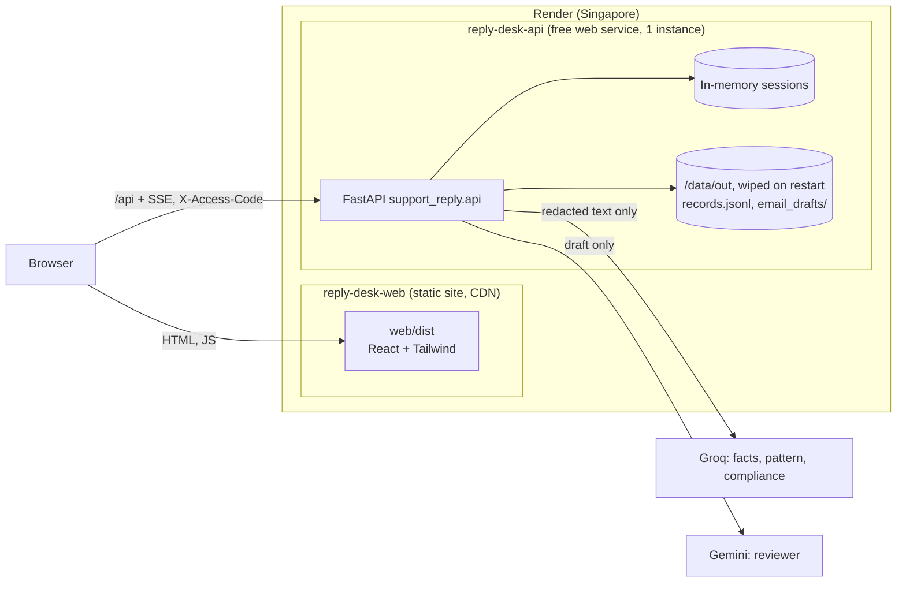
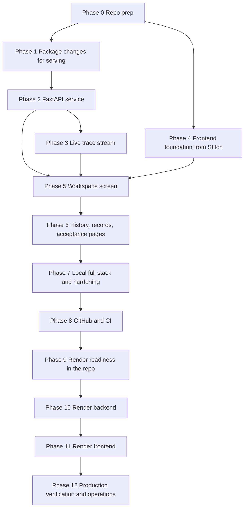

# Deployment Plan: Reply Desk backend and frontend on Render

This plan turns the finished `support_reply` package (Phases 0–10 of `docs/implementation-plan.md`, plus the session CLI) into a web app on Render. The backend is a FastAPI service running as a Render **web service** from the root `Dockerfile`. The frontend is a React app running as a Render **static site**, built from the Stitch designs in `design/stitch/`. Both are defined in one `render.yaml` Blueprint. Everything runs locally first, then goes to GitHub, then deploys.

Every phase below has a testable exit and leaves the next phase able to build on it. The rules from the problem statement still hold in the web layer: facts-only, one citation, no PII stored or logged, three agents in parallel, one reviewer rework, five refinements, and nothing sent without a human approve. The web app adds no send action.

## Status

The earlier version of this plan targeted Railway (backend) and Vercel (frontend). Railway is not working for this project, and Render can host both halves, so the plan now targets Render only.

- **Built and on GitHub:** Phases 0–8 (the API, the web app, the `Dockerfile`, the `Makefile`, and CI). They do not depend on the host, apart from a few leftovers that Phase 9 cleans up.
- **Render readiness (Phase 9):** done. `render.yaml` is committed, `web/vercel.json` is gone, the Railway and Vercel wording is replaced, and the rate limit reads `CF-Connecting-IP` on Render. The API runs on Render's free plan, so it has no disk (see Decisions).
- **Deployed and verified (Phases 10–12), 24 Oct 2026:** `https://reply-desk-api.onrender.com` and `https://reply-desk-web.onrender.com`, with live models (Groq agents, `gemini-3.5-flash` reviewer) and the approval-gated MCP step on. See "Production verification results" in Phase 12.
- **Open:** the two-network rate-limit check (needs a second network), and the cold-start timing. The Google app is in Testing mode, so the Google token must be renewed every 7 days (`make google-auth && make render-env`).

## Decisions

- **One repo, one Blueprint, two Render services.** `render.yaml` at the repo root defines `reply-desk-api` (web service, Docker runtime, built from the root `Dockerfile`) and `reply-desk-web` (static site, root directory `web/`). The Python package stays at the repo root. The frontend lives in `web/`.
- **Backend: FastAPI + uvicorn**, inside the existing package as `support_reply.api`. Endpoints are thin wrappers over `graph.handle_complaint`, `session.refine`, and `gate.approve`. No agent, reviewer, or gate logic moves into the API.
- **Frontend: React + Vite + TypeScript + Tailwind CSS v3.** Tailwind v3 so the Stitch `tailwind.config` objects port directly. TanStack Query for server state, React Router for pages, and API types generated from the backend's OpenAPI schema with `openapi-typescript`.
- **Both services run on Render's free plan, so approved records do not last.** A free web service has 512 MB of memory (the API uses under 100 MB), cannot have a persistent disk, and spins down after 15 minutes without traffic. Approved records (`records.jsonl` and `email_drafts/`) are written to `/data/out` inside the container and are lost on every restart, deploy, and spin-down, together with open sessions. The first request after a spin-down waits about a minute while the instance starts. A workspace gets 750 free instance hours a month, enough for one service running all month. The static site is free and never spins down. To keep records, see "Upgrading to keep records" in Phase 12.
- **Sessions live in memory on one instance.** A session is a short complaint thread. The free plan runs one instance, which matches the in-memory store. A restart, deploy, or spin-down drops open sessions. That is acceptable for a demo.
- **Region: Singapore** for both services. It is the Render region closest to the users of a Groww support desk.
- **The browser calls the API directly.** CORS allows only the static site's origins. In local development, Vite proxies `/api` to `localhost:8000`, so there is no CORS locally. A static-site rewrite that proxies `/api` to the API would remove CORS, but it hides the caller's IP from the rate limiter and adds a hop in front of the SSE stream, so it is not used. Serving the web build from FastAPI would also remove CORS, but it gives up the static site's CDN and the ability to roll back the frontend and backend separately.
- **The client IP comes from `CF-Connecting-IP` on Render.** Render's public services sit behind Cloudflare, which overwrites that header on every request. Render's own proxy appends its address to `X-Forwarded-For`, so the last hop, which the current code uses, is a proxy address and would put every user in one rate-limit bucket. The header to trust becomes a setting (Phase 9).
- **Live trace over SSE.** The parallel fan-out is the core of the demo, so the trace streams while the graph runs. EventSource only supports GET, so the client reads a `fetch` response body as a stream.
- **Approve runs the approval-gated MCP step inside the API.** Reply Desk's MCP server (`mcp-server/`, from Milestone 2 without its send tool or HTTP transport) is built into the API image and started as a stdio subprocess on each approve. It appends the redacted record to a Google Doc and creates a Gmail draft with no recipient. There is no public MCP endpoint and no third service. The local record is written first; a Google failure is reported per step and never undoes the approval. It is off until `REPLY_DESK_MCP=on`.
- **Model mode is a server setting.** `REPLY_DESK_MODELS=auto` uses Groq/Gemini when keys are set. `off` forces the cue tables for every request without touching the environment. CI, e2e tests, and the acceptance endpoint run with `off`.
- **A shared access code guards the public URL.** Each turn costs three Groq calls and one Gemini call. If `ACCESS_CODE` is set, every `/api` call except `/api/health` needs the `X-Access-Code` header. This is a speed bump against quota abuse, not user auth.
- **Deploys wait for CI.** Both services use Render's "After CI checks pass" auto-deploy trigger (`autoDeployTrigger: checksPass`), so a red `main` never ships.
- **Stitch output is a design reference, not shipped code.** Markup is ported into components. Everything on screen comes from the API. Invented content is removed (see Phase 5).

## Topology



## Layout after this plan

```
.
├── render.yaml                # Blueprint: reply-desk-api + reply-desk-web
├── Dockerfile                 # backend image Render builds
├── .dockerignore
├── .python-version            # 3.12
├── Makefile                   # dev-api, dev-web, test, e2e, docker-run
├── README.md
├── pyproject.toml / uv.lock
├── data/                      # read-only corpus, baked into the image
├── src/support_reply/
│   ├── ...                    # existing package
│   └── api/
│       ├── __init__.py
│       ├── app.py             # FastAPI app, CORS, access code, error handlers
│       ├── settings.py        # env-driven settings (access code, origins, limits, IP header)
│       ├── service.py         # turn logic shared by the JSON and SSE routes
│       ├── schemas.py         # pydantic response models mirroring to_dict()
│       ├── store.py           # in-memory session store, TTL, per-session lock
│       ├── stream.py          # SSE trace streaming
│       └── limits.py          # per-IP rate limit, model-call semaphore
├── tests/                     # + test_api_*.py
├── web/
│   ├── package.json / package-lock.json / .nvmrc (22)
│   ├── tailwind.config.ts     # merged Stitch tokens
│   ├── index.html
│   ├── src/
│   │   ├── api/               # client.ts, stream.ts, types.gen.ts (generated)
│   │   ├── components/        # ported from the Stitch screens
│   │   ├── pages/             # Workspace, Records, Acceptance
│   │   └── main.tsx
│   └── e2e/                   # Playwright specs
├── design/stitch/             # Stitch reference screens
└── .github/workflows/ci.yml
```

`web/vercel.json` is gone: the SPA rewrite and the security headers move to the static site in `render.yaml`. `out/` stays gitignored. Locally it holds records from local approvals. On Render it is `/data/out` inside the container, which is wiped on every restart.

## Dependency order



All phases are built and deployed. Production results are in Phase 12.

---

## Phase 0 — Repo prep

**Build**

- `git init` at the project root. Before the first commit, extend `.gitignore` with `node_modules/`, `web/dist/`, `web/test-results/`, `web/playwright-report/`, `.DS_Store`, `uv-*.lock`, and `.env.*` (but not `.env.example`). `.env` and `out/` are already listed.
- Delete the stray empty `uv-1937df49857b104d.lock`.
- Move `stitch_reply_desk_fintech_dashboard/` to `design/stitch/` and keep all seven screens plus `reply_desk_operational_workspace/DESIGN.md` as the design reference. Nothing in `design/` is built or deployed.
- Add `.python-version` with `3.12`. Locally uv currently picks 3.14; the Docker image and CI must match, and 3.12 is the conservative choice for `langgraph`, `groq`, and `google-genai`.
- Add a `README.md`: what the system is, how to run tests, the CLI, the acceptance run, and (after Phase 7) the full stack.

**Exit**

- `uv sync && uv run pytest` passes on Python 3.12.
- `git status --ignored` shows `.env` as ignored. `git ls-files` lists no `.env`, no `out/`, and no `.venv/`.

---

## Phase 1 — Package changes for serving

The package was built for one process and one user. Four small changes make it safe to serve.

**Build**

1. **Cue-only mode without editing the environment.** Today `accept --offline` and `cli --offline` pop the API keys from `os.environ`. In a server that would switch off models for every concurrent request. Add a `llm.CUES_ONLY` sentinel: `classify_or_none` returns `None` for it without logging a failure. `handle_complaint`, `refine`, and `run` pass it through like any classifier. `REPLY_DESK_MODELS=off` makes the API pass `CUES_ONLY` for both the agents and the reviewer.
2. **Configurable output directory.** `gate.default_out_dir()` reads `REPLY_DESK_OUT_DIR` first, then falls back to the repo `out/`. Render sets it to `/data/out`.
3. **Provenance per node.** Each agent subgraph's classify step records whether its pick came from the model or the cues. The parent graph collects this in a `provenance` channel (`{"facts": "model" | "cues", ...}`, plus `reviewer`), returned by `graph.run` beside the session. This is not added to the contracts, so `Session.to_dict()` is unchanged. The UI shows a small `model` or `cues` tag on each agent card, so a quota fallback is visible.
4. **Acceptance as data.** `accept.run_all` gains a structured report (`report() -> dict`): the 20 review ids with outcomes, four branches with traces and `agents_fired`, the advice turns, and both cap checks. The text output is built from that dict. The report writes approvals into a temporary directory, never into the real records.

**Exit**

- `REPLY_DESK_MODELS=off` with real keys in `.env` makes zero model calls (a counting fake proves it), and two threads, one `off` and one `auto`, do not affect each other.
- `REPLY_DESK_OUT_DIR=/tmp/x` sends `approve` writes to `/tmp/x`.
- `provenance` reads `cues` for all four nodes offline, and `model` when a fake classifier answers.
- `accept.report()` matches the existing text run and leaves the real `out/` untouched.
- The existing 270 tests still pass.

---

## Phase 2 — FastAPI service

**Build**

Add `fastapi` and `uvicorn[standard]` to the project dependencies. `support_reply.api.app:app` serves:

| Method and path | Calls | Returns | Errors |
|---|---|---|---|
| `GET /api/health` | — | `status`, model mode per node (`groq`/`cues`, `gemini`/`code`), corpus date `25-Jun-2026`, review window | — |
| `POST /api/sessions` `{complaint}` | `handle_complaint` | `session_id`, `session` (`to_dict()`), `trace`, `provenance`, `approvable` | 400 empty or over 2,000 chars |
| `GET /api/sessions` | store | summaries: id, redacted excerpt, disposition, priority, review status, refinements, updated_at | — |
| `GET /api/sessions/{id}` | store | as POST | 404 |
| `POST /api/sessions/{id}/refine` `{pushback}` | `refine` | as POST, plus the new `agents_fired` entry | 404, 409 limit reached |
| `POST /api/sessions/{id}/replace` `{complaint}` | `refine(complaint=...)` | as refine | 404, 409 |
| `POST /api/sessions/{id}/messages` `{message}` | `handle_complaint` on the same session | as POST | 404 |
| `POST /api/sessions/{id}/approve` | `approve(human_approved=True, session_id=id)` | record summary, email file name | 404, 409 not approvable |
| `GET /api/records` | read `records.jsonl` | records, newest first; filter by disposition, priority, team | — |
| `GET /api/records/{session_id}/email` | read the draft file | the email text | 404 |
| `POST /api/acceptance/run` | `accept.report()` with `CUES_ONLY` | the report | 429 if one is already running |
| `GET /api/acceptance` | — | the last report, or 404 | 404 |

The approve endpoint is the human click. It passes `human_approved=True` because a person pressed the button; the gate still refuses anything that is not a reviewer `pass`. There is no endpoint that sends.

**Session store (`store.py`).** A dict of `session_id -> Session` with a lock per session, so two refines on one thread cannot interleave. The `session_id` comes from `gate.new_session_id()` and is reused as the email draft name. Sessions idle for 2 hours expire; at 200 sessions the oldest idle one is evicted. The store holds `Session` objects only, which carry redacted text only.

**PII in the web layer.**

- Complaint text travels only in POST bodies, never in a URL or query string.
- FastAPI's default 422 response echoes the request body in `detail[].input`. Replace the `RequestValidationError` handler with one that returns the field name and the error type only. Do the same for 500 responses: a generic message and a request id, never the body.
- uvicorn access logs record method, path, and status only. Do not add body logging middleware. The package's own loggers already print redacted reprs. Set the level with `LOG_LEVEL` (default `INFO`).

**Guards (`app.py`, `limits.py`).**

- CORS: `ALLOWED_ORIGINS` (comma-separated exact origins) plus an optional `ALLOWED_ORIGIN_REGEX` for the static site's pull request previews. Methods `GET, POST`. Headers `Content-Type, X-Access-Code`.
- Access code: when `ACCESS_CODE` is set, every `/api` route except `/api/health` compares `X-Access-Code` with `hmac.compare_digest` and returns 401 on a miss.
- Rate limit: per-IP token bucket on model-backed routes (default 12 turns per minute). How the client IP is found behind a proxy is set in Phase 9. A global semaphore allows two graph runs at once, so three parallel Groq calls per turn stay inside the free tier's 8,000 tokens per minute.
- Request bodies over 8 KB are rejected before they are parsed.

**Exit**

- `uv run uvicorn support_reply.api.app:app --reload --port 8000` serves `/docs`.
- `tests/test_api_*.py` (FastAPI `TestClient`, `REPLY_DESK_MODELS=off`) covers:
  - the four acceptance branches through `POST /api/sessions`
  - Shorter, different-scheme, and fee-issue refines with their `agents_fired`
  - the 409 on a sixth refine
  - the advice thread via `/messages`
  - approve writing to a temporary `REPLY_DESK_OUT_DIR`
  - a forced blocked session returning 409 on approve and writing nothing
- A PII test posts the fixture PAN and phone and asserts that neither appears in any response body, in captured logs, or in a 422 response from a malformed body that contained them.
- CORS rejects an origin outside the list. A missing access code gets 401 when `ACCESS_CODE` is set. The 13th turn in a minute from one IP gets 429.

---

## Phase 3 — Live trace stream

**Build**

- `POST /api/sessions`, `/refine`, `/replace`, and `/messages` accept `Accept: text/event-stream`. The handler runs the graph in a worker thread and passes a `Trace` subclass whose `record()` also puts each event on a queue. The response streams:
  - `event: trace` with `{seq, node, kind, elapsed_ms}` for every start and return, as they happen
  - `event: result` with the same body as the JSON response
  - `event: error` with a generic message, if the run fails
- Without that header, the routes answer with plain JSON as in Phase 2. Tests and simple clients keep working.
- Response headers `Cache-Control: no-store` and `X-Accel-Buffering: no`, and a comment heartbeat every 10 seconds, keep proxies from buffering the stream.

**Exit**

- A streamed clean-hit turn delivers three agent `start` events before any agent `return`, then `draft`, then `reviewer`, then `result`. The sequence equals the JSON response's `trace`.
- A streamed refine that re-runs Facts only emits no Pattern or Compliance events.
- A client that disconnects mid-stream does not leave the session half-updated: the session changes only when the graph finishes, as `refine` already guarantees.

---

## Phase 4 — Frontend foundation from Stitch

**Build**

- Scaffold `web/` with Vite (React + TypeScript), Tailwind CSS v3, React Router, TanStack Query, Vitest, React Testing Library, and Playwright. Pin Node 22 in `.nvmrc` and `engines`.
- **One Tailwind config from seven screens.** Each `design/stitch/*/code.html` has its own inline `tailwind.config`, and the markup also uses raw hex classes (`bg-[#121821]`, `border-[#243042]`). Merge them into `web/tailwind.config.ts`:
  - the Material-style tokens from `DESIGN.md` front matter (`surface`, `surface-container-*`, `on-surface`, `primary`, `outline-variant`, …), which is what the screens render
  - the type scale (`headline-lg/md/sm`, `body-md/sm/xs`, `label-mono`, `trace-mono`, `code-inline`), spacing (`space-xs`…`space-xl`, `gutter`, `margin-panel`), and radii
  - named tokens for the hex values the markup hard-codes: `canvas #0B0F14`, `panel #121821`, `raised #18202B`, `line #243042`, `agent-facts #58A6FF`, `agent-pattern #A371F7`, `agent-compliance #D29922`, `ok #3FB950`, `warn #D29922`, `danger #F85149`

  When porting markup, replace every `[#hex]` class with its token.
- **No CDN at runtime.** Tailwind is compiled at build time instead of `cdn.tailwindcss.com`. Inter and JetBrains Mono come from `@fontsource`. Material Symbols becomes `@material-symbols/font-400` (outlined) or inline SVG icons. The Stitch logo and avatar hotlink `lh3.googleusercontent.com`; replace the logo with a local SVG and drop the avatar.
- **App shell** from the shared header of the Stitch screens, with real values only:

  | Stitch placeholder | Replace with |
  |---|---|
  | `PROD / SEBI COMPLIANT ENCLAVE`, `Orchestrator v2.4 • SEBI Rulepack 2026.3` | Environment label (`local` / `production`) and model mode from `/api/health` |
  | `KMS ENCRYPTION`, `ZERO DATA RETENTION`, `UPTIME 99.994%`, `342ms p95` | Corpus `Last checked 25-Jun-2026`, review window `12 Apr – 4 Jul 2026`, API status dot |
  | `A. Sharma, L2 Compliance Specialist` + avatar | Nothing (there is no login) |
  | Nav: `Queue (14)`, `Compliance Audit`, `Agent Metrics`, `Policy Rules` | `Workspace`, `Records`, `Acceptance` |

- **API client.** `npm run gen:api` runs `openapi-typescript` against `http://localhost:8000/openapi.json` into `src/api/types.gen.ts`, which is committed. `client.ts` adds the base URL (`VITE_API_BASE_URL`, empty in dev so the Vite proxy is used) and the access code header. `stream.ts` reads the SSE body. An access-code screen asks once and keeps the code in `sessionStorage`.

**Exit**

- `npm run dev` shows the shell at `localhost:5173`, and the header reads model mode and corpus date from the local API through the Vite proxy.
- `npm run build` succeeds, and a grep of `web/dist` finds no `cdn.tailwindcss.com` and no `googleusercontent.com`.
- `npm run typecheck` passes against the generated types.

---

## Phase 5 — Workspace screen

The workspace is one page. The Stitch variants are states of that page, not separate routes.

**Build**

Port `design/stitch/reply_desk_operations_workspace/` as the base layout: queue on the left, ticket in the center, decision panel on the right. Each block becomes a component fed by one API field:

| Component | Stitch source | Data |
|---|---|---|
| `QueueList` | workspace, left column | `GET /api/sessions` summaries; new-complaint button on top |
| `ComplaintComposer` | — (new, uses the input styles) | `POST /api/sessions`; the textarea is cleared on submit |
| `ComplaintCard` | "Customer Ingress Statement" | `session.redacted_text`; `[PAN]`-style tokens rendered as pills; `pii_types` |
| `FactsCard`, `PatternCard`, `ComplianceCard` | "Agent Analysis Engine" | `session.facts`, `.pattern`, `.compliance`; `provenance` tag on each |
| `DraftCard` | "Generated Reply Draft" | `draft.reply`, `citation` as a source chip, `last_checked`, sentence count |
| `TraceTimeline` | "Execution Trace Timeline" | streamed trace events; bars grow live; offsets from `elapsed_ms` |
| `ReviewerPanel` | "Automated Reviewer" | `review.status`, `round`, the five checks, `failures` |
| `RoutingCard` | "Routing Metadata" | `draft.routing_note` (team, priority, why); "Ticket stays open" for escalate and disagree |
| `RefinePanel` | "Refine Draft" | `/refine` with chips Shorter, Different scheme, Check fee issue from last week; counter `refinement_count / 5`; re-run footprint from the cue rules |
| `ApproveBar` | footer of the right column | rendered only when `approvable`; `/approve`; "Nothing is sent." |
| `MessageInput` | — | `/messages` for a new user turn in the same thread |

State variants, driven by `draft.disposition` and `review.status`:

| State | Stitch reference | What changes |
|---|---|---|
| `refuse` | `reply_desk_advice_refusal_variant` | Sticky-refusal badge in the header when `advice_refusal`; Compliance flag chips lit; no citation chip |
| `handoff` | `reply_desk_order_failed_uncovered_corpus_variant` | Facts card shows "Not covered" and the searched grid (5 schemes × 7 sections from `facts.searched`); no URL in the draft |
| `blocked` | `reply_desk_review_blocked_round_2_of_2` | Offending spans from `review.failures[].detail` highlighted in the draft; the approve bar is replaced by "Approval unavailable: draft failed review twice"; refine stays available |
| `disagree` | workspace | Disagreement banner with `pattern.recent_count` |
| `escalate`, `reply` | workspace | As designed |

**Content removed from the Stitch markup** (it contradicts the system or invents data):

- Long, multi-paragraph drafts with allotment dates, rupee amounts, and day counts. The real draft is the copied fact, `Last checked …`, and `Source: <groww url>`.
- "We strongly recommend consulting…" in the refusal draft. The real `REFUSAL_REPLY` text is used, and it passes the reviewer.
- Customer names, folio numbers, KYC tier, SLA timers, "SEBI Reg Flag", "Custodial truth source", NAV/units panels, confidence percentages, "+340%" spikes, and the `UPI_REF` token. None of these exist in the data.
- "Dispatch", "Dispatch gate sealed", "Regenerate sentence 2", "View raw tokens", and "Deterministic seed". There is no send, no per-sentence regeneration, and no raw view, by design.
- Citations shown as PDF section references (`SID §4.2`). Citations are the Groww `source_url`.

**Frontend PII rules**

- Complaint and pushback text exist only in component state until submit, then the input is cleared. They are never put in the URL, `localStorage`, or analytics.
- Only `session_id` goes in the URL (`/s/:id`).
- Nothing on screen renders a raw value. The API never returns one, and a Vitest check asserts that no component renders the fixture PAN when given a fixture session.

**Exit**

- Vitest renders each state from fixture JSON (captured from the Phase 2 API) and matches the expected labels: refuse shows no citation, blocked shows no approve, handoff shows no URL.
- Playwright against the local API in `REPLY_DESK_MODELS=off` mode:
  - the four branches from `support_reply.fixtures`
  - Shorter re-runs only the orchestrator (the timeline shows no agent bars)
  - a different scheme re-runs Facts only and switches to the gold URL
  - the 6th refine is refused
  - the six-turn advice thread stays refused
  - approve creates a record that the Records page lists
- For a clean hit, the live timeline shows three agent bars starting before any ends.

---

## Phase 6 — History, records, and acceptance pages

**Build**

- **Refinement history drawer** from `reply_desk_refinement_history_modal`. One entry per `agents_fired` item: round, kind, `ran` chips in agent colors, `skipped` chips outlined. A `reviewer_rework` entry is dashed and labelled "Reviewer rework: orchestrator only", with round `0` on the first complaint, not "0.5". At 5 of 5, the disabled input reads "Refinement limit reached, last reviewed draft kept". Remove "Use approved draft", "Escalate", drift metrics, and operator handles.
- **Records page** from `reply_desk_approved_records`. Table columns: session id, `approved_at`, disposition, priority, team, pattern signal, citation domain. Filters: disposition, priority, team. Summary tiles show only counts computed from the records (total, by disposition). The side drawer shows the email draft text from `/api/records/{id}/email` under a fixed "Draft only — not sent" banner.
  - Remove "Export audit bundle", "Live sync", "HSM signature", "Canonical hash", "Re-verify", "Approved by", the `DISPATCHED … via HSM queue` line, and the "HDFC AMC Investor Relations Team" signature (the app must not sign as a real company).
  - A plain "Export CSV" built in the browser from the loaded rows may stay.
- **Acceptance page** from `reply_desk_qa_acceptance_run_report`, fed by `GET /api/acceptance` with a "Run (cues only)" button on `POST /api/acceptance/run`:
  - the summary banner
  - four branch cards, each with a mini trace
  - the two cap checks
  - the six advice turns
  - the 20-review table, showing ids, outcomes, theme, and review status only, never review text (the report does not contain it)

  Remove "Enclave audit stamp", "Re-run suite" wording that implies production, convergence and entropy metrics, and the invented UTI / Parag Parikh / Tata rows. With real data, all 20 rows are `handoff`.

**Exit**

- Playwright opens the drawer after three refines and sees three entries with the right ran/skipped chips.
- An approved session appears on the Records page with its email text.
- The acceptance page shows PASS from a fresh run, and the real `out/records.jsonl` is unchanged by that run.

---

## Phase 7 — Local full stack and hardening

**Build**

- **`Makefile`**:
  - `make dev-api` runs uvicorn with `--reload`
  - `make dev-web` runs Vite
  - `make dev` runs both
  - `make test` runs pytest and Vitest
  - `make e2e` starts the API with `REPLY_DESK_MODELS=off`, builds and previews the web app, and runs Playwright
  - `make docker-run` builds and runs the production image on port 8000
- **`Dockerfile`** (root, built by Render):
  - `python:3.12-slim` base, plus the `uv` binary from the official uv image, pinned to the version you run locally
  - `uv sync --frozen --no-dev`
  - copies `src/` and `data/`, runs as a non-root user
  - `CMD uvicorn support_reply.api.app:app --host 0.0.0.0 --port ${PORT:-8000} --proxy-headers --forwarded-allow-ips="*"`
- **`.dockerignore`**: `.venv`, `.env`, `out/`, `web/`, `design/`, `tests/`, `docs/`, `.pytest_cache`.
- **Security headers and the SPA rewrite** were first written as `web/vercel.json`. Phase 9 moves them to the static site in `render.yaml`.
- **Local env files**:
  - root `.env`: keys plus `REPLY_DESK_MODELS`, `ACCESS_CODE`, `ALLOWED_ORIGINS`, `REPLY_DESK_OUT_DIR`, `LOG_LEVEL`
  - `web/.env.local`: `VITE_API_BASE_URL` empty for the proxy
  - update `.env.example` and add `web/.env.example`

**Exit**

- From a fresh clone: `uv sync`, `cd web && npm ci`, then `make dev`. The app works in `auto` mode with keys and in `off` mode without them.
- `make test` and `make e2e` pass with no network access.
- `make docker-run` serves `/api/health`, and the web app pointed at it (`VITE_API_BASE_URL=http://localhost:8000`, with that origin in `ALLOWED_ORIGINS`) completes a clean-hit approve. This proves the production image and the CORS path before any cloud step.
- PII audit: run the PII branch through the UI, then grep the API logs, the browser's `localStorage` and `sessionStorage`, `out/`, and the network responses for the raw PAN and phone. Nothing is found.

---

## Phase 8 — GitHub and CI

**Build**

- Create a GitHub repository (private is recommended until the access code and limits are proven) and push `main`. Before the first push, confirm `git ls-files | grep -E '(^|/)\.env$'` prints nothing.
- **`.github/workflows/ci.yml`** on pull requests and on `main`:
  - `backend`: set up uv, `uv sync --frozen`, `uv run pytest`, `uv run python -m support_reply.accept --offline --out "$RUNNER_TEMP/out"`
  - `web`: Node 22, `npm ci`, `npm run lint`, `npm run typecheck`, `npm run test`, `npm run build`
  - `e2e`: start the API with `REPLY_DESK_MODELS=off`, `npx playwright install --with-deps chromium`, `npm run e2e`, and upload the Playwright report on failure
  - `docker`: `docker build .` (no push)
  - CI needs no secrets: every job runs on the cue tables.
- Protect `main`: require the four jobs and a pull request. Render's `checksPass` trigger (Phase 10) reads these same checks.

**Exit**

- A pull request runs all four jobs green.
- The repository contains no `.env`, no `out/`, no `node_modules/`, and no build output.

---

## Phase 9 — Render readiness in the repo

Everything Render needs is committed and tested before anything is created in the Render dashboard.

**Build**

1. **Client IP behind Render's proxy.** Today `limits.client_ip` takes the last `X-Forwarded-For` hop, which was the client on Railway. On Render it is a proxy address, so every caller would share one rate-limit bucket. Add a setting `REPLY_DESK_CLIENT_IP_HEADER` to `Settings.from_env`:
   - When set (Render: `CF-Connecting-IP`), `client_ip` reads that header first. Cloudflare overwrites it on every request to a public Render service, so a caller cannot forge it there.
   - When the header is missing, or the setting is unset (local, `make docker-run`, CI), the current rule stays: the last `X-Forwarded-For` hop, then the socket peer.
   - Set it only on a host that sits behind Cloudflare. Anywhere else, a client could send the header and pick its own bucket.
2. **`render.yaml` Blueprint** at the repo root:

   ```yaml
   services:
     - type: web
       name: reply-desk-api
       runtime: docker
       plan: free
       region: singapore
       dockerfilePath: ./Dockerfile
       dockerContext: .
       healthCheckPath: /api/health
       autoDeployTrigger: checksPass
       buildFilter:
         paths:
           - Dockerfile
           - .dockerignore
           - pyproject.toml
           - uv.lock
           - .python-version
           - src/**
           - data/**
       envVars:
         - key: GROQ_API_KEY
           sync: false
         - key: GEMINI_API_KEY
           sync: false
         - key: ACCESS_CODE
           generateValue: true
         - key: ALLOWED_ORIGINS
           sync: false
         - key: ALLOWED_ORIGIN_REGEX
           sync: false
         - key: REPLY_DESK_MODELS
           value: auto
         - key: REPLY_DESK_OUT_DIR
           value: /data/out
         - key: REPLY_DESK_ENV
           value: production
         - key: REPLY_DESK_CLIENT_IP_HEADER
           value: CF-Connecting-IP
         - key: LOG_LEVEL
           value: INFO

     - type: web
       name: reply-desk-web
       runtime: static
       rootDir: web
       buildCommand: npm ci && npm run build
       staticPublishPath: ./dist
       autoDeployTrigger: checksPass
       envVars:
         - key: NODE_VERSION
           value: "22"
         - key: VITE_API_BASE_URL
           sync: false
       routes:
         - type: rewrite
           source: /*
           destination: /index.html
       headers:
         - path: /*
           name: Content-Security-Policy
           value: "default-src 'self'; script-src 'self'; style-src 'self'; font-src 'self' data:; img-src 'self' data:; connect-src 'self' https://reply-desk-api.onrender.com; object-src 'none'; base-uri 'self'; form-action 'self'; frame-ancestors 'none'"
         - path: /*
           name: X-Content-Type-Options
           value: nosniff
         - path: /*
           name: Referrer-Policy
           value: no-referrer
         - path: /*
           name: Permissions-Policy
           value: camera=(), microphone=(), geolocation=()
         - path: /*
           name: X-Frame-Options
           value: DENY
         - path: /assets/*
           name: Cache-Control
           value: public, max-age=31536000, immutable
   ```

   Notes on the Blueprint:
   - `sync: false` values are never in the repo. Render asks for them when the Blueprint is first applied.
   - `generateValue: true` makes Render create a random `ACCESS_CODE`. Copy it from the dashboard and share it with demo users out of band.
   - `rootDir: web` means only changes under `web/` redeploy the static site. `buildFilter` does the same for the API, so a docs-only or web-only commit does not restart it and drop open sessions.
   - Render does not apply a rewrite to a path where a file exists, so `/assets/*` is served as built and every other path falls back to `index.html`.
   - The CSP names `reply-desk-api.onrender.com`. If Render adds a suffix because the name is taken, Phase 11 corrects it.
   - No service sets `branch`, so both deploy from the repo's default branch, `main`.
3. **Delete `web/vercel.json`.** Its rewrite and headers now live in `render.yaml`.
4. **Replace the Railway and Vercel wording:**
   - `Dockerfile`: header comment says Render builds the image, and the `RAILWAY_RUN_UID` note becomes the Render disk note below.
   - `gate.py` (`default_out_dir` docstring), `limits.py` (`client_ip` docstring), and the `Makefile` comment on `docker-run`.
   - `.env.example`: comments for `ACCESS_CODE` and `ALLOWED_ORIGIN_REGEX` refer to Render. Add `REPLY_DESK_CLIENT_IP_HEADER`, blank, with a one-line comment.
   - `web/.env.example`: `VITE_API_BASE_URL` comment names the Render API URL.
   - `README.md`: the deploy section describes `render.yaml`, and the status line points at this plan's Phases 10–12.
5. **Disk permissions (only after upgrading to a disk).** The image runs as the non-root user `app` (uid 10001) and owns `/data/out` at build time. A Render disk mounted over that path may be owned by root. Keep the non-root user. If approve cannot write once a disk is added, add a small entrypoint that runs as root, `chown`s `/data/out` to `app`, and then starts uvicorn as `app` with `setpriv`, which is already in the slim image. Do not drop the `USER` line instead.

**Exit**

- New tests in `tests/test_api_guards.py`:
  - with `REPLY_DESK_CLIENT_IP_HEADER=CF-Connecting-IP`, two requests with different `CF-Connecting-IP` values and the same `X-Forwarded-For` land in different buckets
  - with the setting, a request without the header falls back to the last `X-Forwarded-For` hop
  - without the setting, a forged `CF-Connecting-IP` is ignored
- `uv run pytest`, `make test`, `make e2e`, and `make docker-run` still pass.
- `git grep -n -i -E 'railway|vercel'` finds nothing outside `docs/`.
- `render.yaml` validates: the Render dashboard's Blueprint preview (or `render blueprints validate` with the Render CLI) shows two services and no errors.
- CI is green on the pull request that carries these changes.

---

## Phase 10 — Render backend

**Build**

- In the Render dashboard, choose **New → Blueprint**, connect the GitHub repo, and select `render.yaml` on `main`. Render shows both services. Enter the `sync: false` values:

  | Name | Value |
  |---|---|
  | `GROQ_API_KEY`, `GEMINI_API_KEY` | Your keys |
  | `ALLOWED_ORIGINS` | Leave blank for now; filled in Phase 11 |
  | `ALLOWED_ORIGIN_REGEX` | Leave blank |
  | `VITE_API_BASE_URL` (static site) | `https://reply-desk-api.onrender.com`, or leave blank until the API URL is known |

  `GROQ_MODEL` and `GEMINI_MODEL` are optional; the defaults are in `llm.py`. Render sets `PORT`, and the `Dockerfile` reads it.

  For the approval-gated MCP step, also set `REPLY_DESK_MCP` (`on`), `REPLY_DESK_DOC_ID`, `GOOGLE_CLIENT_ID`, `GOOGLE_CLIENT_SECRET`, and `GOOGLE_TOKEN_JSON` (the contents of `mcp-server/data/google-token.json` after `npm run auth`). `mcp-server/README.md` has the Google setup. `make google-auth` gets the token, and `make render-env` (with a Render API key in `~/.render-api-key`) sets all five on the service and redeploys. While the Google app is in Testing mode the token lasts 7 days, so run both again weekly.
- Apply the Blueprint. The API builds the `Dockerfile` on the free plan and goes live once `/api/health` answers.
- Note the API's public URL from its dashboard page. If it is not `https://reply-desk-api.onrender.com`, update the CSP `connect-src` in `render.yaml` in a pull request.
- Copy the generated `ACCESS_CODE` from the API's Environment page.

**Exit**

- `curl https://reply-desk-api.onrender.com/api/health` shows `groq` and `gemini` as the model modes and `production` as the environment.
- With the access code, a `POST /api/sessions` clean hit returns `escalate` with the large-cap citation, and `provenance` shows `model` for all four nodes.
- A streamed `POST /api/sessions` with `Accept: text/event-stream` (`curl -N`) prints `trace` events one by one, not all at the end.
- `POST /api/acceptance/run` returns PASS.
- Approve one session. It is listed by `GET /api/records`. After a manual deploy the list is empty again; on the free plan that is expected.
- After 15 minutes with no requests, the next `/api/health` takes up to a minute, then answers.
- The Render logs for a PII complaint show `[PAN]`, never the raw value.
- Rate limit by caller: 12 turns from one network, then the 13th gets 429, while a second network (a phone hotspot) still gets answers. If both networks are limited together, the client IP header is not being read.

---

## Phase 11 — Render frontend

**Build**

- The static site was created with the Blueprint in Phase 10. If `VITE_API_BASE_URL` was left blank, set it now to the API's URL. Vite inlines it at build time, so changing it needs a new deploy of the static site (Render offers this when you save the variable).
- Note the static site's URL (`https://reply-desk-web.onrender.com` or with a suffix).
- On the API, set `ALLOWED_ORIGINS` to that URL, plus any custom domain, comma-separated with no trailing slash. Saving the variable redeploys the API.
- **Pull request previews (optional).** Turn on previews for the static site only, not the API: an API preview would be a second instance drawing on the same 750 free hours. Previews build with the production `VITE_API_BASE_URL`, so they call the production API and still need the access code. Open a test pull request, read the preview's URL, and set `ALLOWED_ORIGIN_REGEX` on the API to match only this site's previews, for example `^https://reply-desk-web-pr-\d+\.onrender\.com$`. Leave it blank if previews stay off.
- **Custom domain (optional).** Add it to the static site in Render, point DNS as Render shows, and add the domain to `ALLOWED_ORIGINS`.

**Exit**

- The production URL loads, asks for the access code, and shows `production`, the model mode, and the corpus date in the header.
- A deep link such as `/s/<id>` or `/records`, opened in a new tab, loads the app, not a 404.
- Browser dev tools show no CORS errors and no CSP violations, the response headers include the CSP and `X-Frame-Options: DENY`, and the SSE stream arrives incrementally.
- If previews are on: a preview reaches the API when the regex is set, and is rejected by CORS when it is not.

---

## Phase 12 — Production verification and operations

**Build: the production smoke checklist** (run after every release). `make e2e-prod`, with `E2E_ACCESS_CODE` set in the shell, runs the Playwright suite against the Render URLs and covers all seven items. It makes live model calls (about 20 turns) and approves a few redacted records.

1. Clean hit: `escalate`, large-cap citation, `Last checked 25-Jun-2026`, three agent bars overlapping in the live timeline.
2. Corpus miss: `handoff`, no URL, the searched grid filled.
3. Recurring theme: `fees_brokerage`, 136 reviews, "Ticket stays open".
4. PII: `[PAN]` and `[PHONE]` pills, reviewer PII check passes, approve, and the record and email show tokens only.
5. Advice: redeem, then "is it good", then returns, then a rephrase, all refused, with the sticky badge.
6. Refine: Shorter (orchestrator only), gold scheme (Facts only), fee issue last week (Pattern only), then the sixth refine refused.
7. Acceptance page: run, PASS.
8. MCP (when `REPLY_DESK_MCP=on`): `/api/health` shows `mcp.enabled` and `mcp.doc_configured`; approve a clean hit, and the approved note shows the Google Doc and the Gmail draft as done. The Doc has a new line with tokens only, and Gmail's Drafts has the reply with no recipient. Nothing appears in Sent.

**Operations**

- **Deploys:** merge to `main`, CI goes green, then Render deploys whichever service the change touched. An API deploy drops open sessions and approved records. Deploy the API outside demo hours.
- **Rollback:** each service's Events page lists past deploys, and **Rollback** redeploys an earlier one (the Render API's `POST /v1/services/{id}/rollback` does the same). The two services are independent, so roll back only the side that broke. A rollback **turns auto-deploy off**, so the fix's merge would not deploy: turn it back on (Settings → Auto-Deploy → After CI checks pass, or `PATCH /v1/services/{id}` with `{"autoDeployTrigger": "checksPass"}`) once the fix is on `main`. A static-site rollback is served about 30 seconds after it goes live, and the CDN can keep the previous `index.html` for up to 5 minutes (`s-maxage=300`).
- **Keys:** rotate the Groq and Gemini keys and the access code by changing the API's environment variables. Saving redeploys the API. Nothing in the frontend changes except users entering the new code.
- **Quota:** watch the per-agent `provenance`. A run of `cues` in production means the Groq free tier is exhausted. Raise the plan or lower `REPLY_DESK_RATE_PER_MINUTE`.
- **Records:** on the free plan, `records.jsonl` and the email drafts last only until the next restart, deploy, or spin-down. They contain redacted text only. To keep a copy, use Export CSV on the Records page before then.
- **Cold starts:** the first visitor after 15 idle minutes waits about a minute. Open the site a minute before a demo. An open, visible Reply Desk tab polls `/api/health` every 30 seconds and the queue every 20, which keeps the instance awake; hidden tabs stop polling.
- **Approve with MCP takes 15–25 seconds** on the free instance: it starts Node and makes two Google calls after writing the record. The button shows a spinner meanwhile.
- **Free hours:** if the workspace's 750 instance hours run out, Render suspends the API until the next month.

**Production verification results (24 Oct 2026)**

| Check | Result |
|---|---|
| `make e2e-prod` (smoke items 1–7, live models) | 10 of 10 passed in 1.4 min |
| Clean hit | `escalate`, large-cap citation; `provenance` is `model` for facts, pattern, compliance, and reviewer |
| SSE | 12 trace events, first after 0.15 s, result after 3.2 s |
| PII | no raw PAN or phone in responses; Render log search finds 0 raw values and 15 `[PAN]` lines |
| Approve with MCP (item 8) | Google Doc line appended and Gmail draft created (no recipient, label `DRAFT` only) |
| Acceptance run | pass |
| Rate limit, one network | 14 simultaneous turns: 12 answered, 2 got 429 |
| Forged `CF-Connecting-IP` | rejected by Cloudflare with 403, so the rate-limit key cannot be chosen by a caller |
| Unauthenticated `/api` calls | 401; `/api/health` stays public |
| Static site | deep links load; CSP, `X-Frame-Options: DENY`, and the other headers are served; CORS allows only the site's origin |
| Rollback rehearsal | API and static site each rolled back and forward through the Render API; auto-deploy turned back on afterwards |

**Upgrading to keep records**

In `render.yaml`, set the API's `plan: starter` and add a disk under it:

```yaml
    disk:
      name: reply-desk-out
      mountPath: /data/out
      sizeGB: 1
```

Records then survive restarts and deploys, the service never spins down, and Render snapshots the disk daily. A service with a disk stops the old instance before starting the new one, so each API deploy has a short outage. If approve then fails with a permission error, apply Phase 9 step 5.

**Exit**

- The smoke checklist passes on the production URLs.
- One rollback has been rehearsed on each service.
- A cold start has been timed, so you know how early to open the site before a demo.

---

## What this plan leaves out

- **User accounts and roles.** The access code is a shared gate, not authentication. An operator name on records needs real auth first.
- **Sending email, or any client that could send it.** Approve writes a draft file, as in Milestone 2.
- **More than one backend instance, or zero-downtime API deploys.** Both need the session store moved off the instance (Render Key Value, or Postgres) and the records off the instance.
- **A database for records.** `records.jsonl` is enough for a demo, and it keeps the gate's single append path.
- **Keeping records on the free plan.** That needs a disk (paid) or an external store. The upgrade path is in Phase 12.
- **Full-stack preview environments.** Only the static site gets pull request previews, and they use the production API.
- **Stitch screens shipped as-is**, or any of the invented metrics, compliance labels, or fake data they contained.
- **Live-model acceptance in CI.** CI stays on the cue tables, so it needs no secrets and burns no quota. Live checks are the Phase 12 smoke list.

## Suggested build schedule

| Phase | Focus | Depends on | Status |
|---|---|---|---|
| 0 | Git, ignore rules, design folder, Python pin | — | Built |
| 1 | Cues-only sentinel, out dir, provenance, acceptance report | 0 | Built |
| 2 | FastAPI routes, store, guards, PII-safe errors | 1 | Built |
| 3 | SSE trace stream | 2 | Built |
| 4 | Vite app, merged Stitch tokens, shell, typed client | 0 | Built |
| 5 | Workspace and its states | 2, 3, 4 | Built |
| 6 | History drawer, records, acceptance pages | 5 | Built |
| 7 | Makefile, Dockerfile, full local run, PII audit | 6 | Built |
| 8 | GitHub repo, CI, branch protection | 7 | Built |
| 9 | Client IP header, `render.yaml`, remove Vercel and Railway leftovers | 8 | Built |
| 10 | Render Blueprint, free API service, variables | 9 | Deployed |
| 11 | Static site, API URL, CORS handshake, previews | 10 | Deployed (previews off) |
| 12 | Production smoke, rollback rehearsal, cold-start check | 11 | Verified (two-network check open) |
