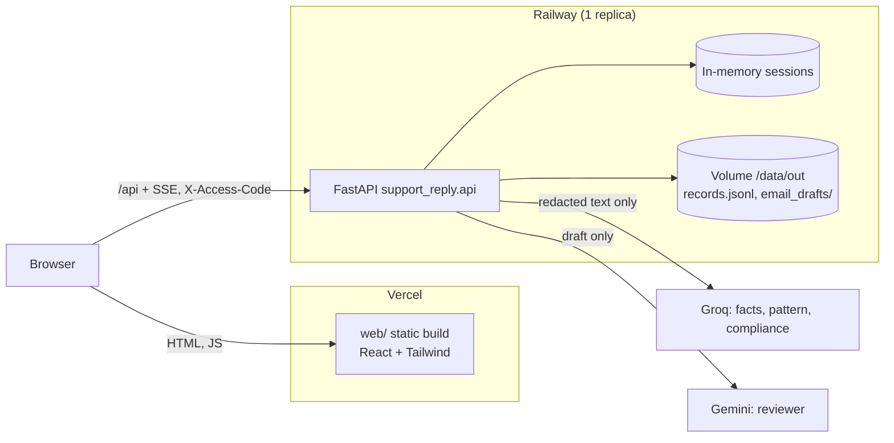
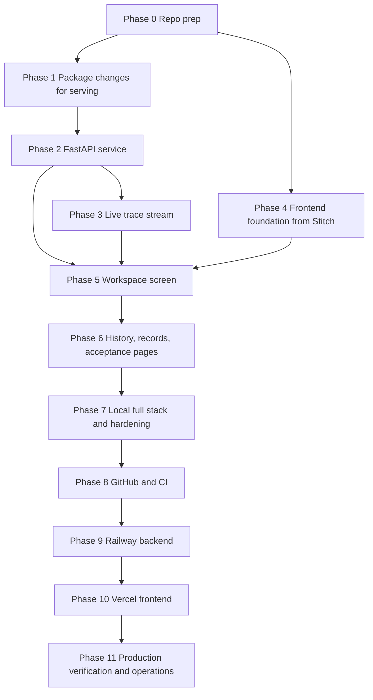

# Deployment Plan: Reply Desk frontend (Vercel) and backend (Railway)

This plan turns the finished `support_reply` package (Phases 0–10 of `docs/implementation-plan.md`, plus the session CLI) into a web app. The backend is a FastAPI service on Railway. The frontend is a React app on Vercel, built from the Stitch designs in `design/stitch/` (moved from `stitch_reply_desk_fintech_dashboard/` in Phase 0). Everything runs locally first, then goes to GitHub, then deploys.

Every phase below has a testable exit and leaves the next phase able to build on it. The rules from the problem statement still hold in the web layer: facts-only, one citation, no PII stored or logged, three agents in parallel, one reviewer rework, five refinements, and nothing sent without a human approve. The web app adds no send action.

## Decisions

- **One repo, two deploy targets.** The Python package stays at the repo root. The frontend lives in `web/`. Railway builds the root `Dockerfile`; Vercel builds `web/` only.
- **Backend: FastAPI + uvicorn**, inside the existing package as `support_reply.api`. Endpoints are thin wrappers over `graph.handle_complaint`, `session.refine`, and `gate.approve`. No agent, reviewer, or gate logic moves into the API.
- **Frontend: React + Vite + TypeScript + Tailwind CSS v3.** Tailwind v3 so the Stitch `tailwind.config` objects port directly. TanStack Query for server state, React Router for pages, and API types generated from the backend's OpenAPI schema with `openapi-typescript`.
- **Sessions live in memory on one backend replica.** A session is a short complaint thread. Approved records persist on a Railway volume (`records.jsonl` and `email_drafts/`). A backend restart drops open sessions, never approved records. Railway runs exactly one replica.
- **The browser calls Railway directly.** CORS allows only the Vercel origins. In local development, Vite proxies `/api` to `localhost:8000`, so there is no CORS locally.
- **Live trace over SSE.** The parallel fan-out is the core of the demo, so the trace streams while the graph runs. EventSource only supports GET, so the client reads a `fetch` response body as a stream.
- **Model mode is a server setting.** `REPLY_DESK_MODELS=auto` uses Groq/Gemini when keys are set. `off` forces the cue tables for every request without touching the environment. CI, e2e tests, and the acceptance endpoint run with `off`.
- **A shared access code guards the public URL.** Each turn costs three Groq calls and one Gemini call. If `ACCESS_CODE` is set, every `/api` call except `/api/health` needs the `X-Access-Code` header. This is a speed bump against quota abuse, not user auth.
- **Stitch output is a design reference, not shipped code.** Markup is ported into components. Everything on screen comes from the API. Invented content is removed (see Phase 4).

## Topology



## Layout after this plan

```
.
├── Dockerfile                 # Railway backend image
├── .dockerignore
├── .python-version            # 3.12
├── Makefile                   # dev-api, dev-web, test, e2e, docker-run
├── README.md
├── pyproject.toml / uv.lock
├── data/                      # read-only corpus, baked into the image
├── src/support_reply/
│   ├── ...                    # existing package
│   └── api/
│       ├── __init__.py
│       ├── app.py             # FastAPI app, CORS, access code, error handlers
│       ├── settings.py        # env-driven settings (access code, origins, limits)
│       ├── service.py         # turn logic shared by the JSON and SSE routes
│       ├── schemas.py         # pydantic response models mirroring to_dict()
│       ├── store.py           # in-memory session store, TTL, per-session lock
│       ├── stream.py          # SSE trace streaming
│       └── limits.py          # per-IP rate limit, model-call semaphore
├── tests/                     # + test_api_*.py
├── web/
│   ├── package.json / package-lock.json / .nvmrc (22)
│   ├── vercel.json            # SPA rewrite, security headers
│   ├── tailwind.config.ts     # merged Stitch tokens
│   ├── index.html
│   ├── src/
│   │   ├── api/               # client.ts, stream.ts, types.gen.ts (generated)
│   │   ├── components/        # ported from the Stitch screens
│   │   ├── pages/             # Workspace, Records, Acceptance
│   │   └── main.tsx
│   └── e2e/                   # Playwright specs
├── design/stitch/             # moved from stitch_reply_desk_fintech_dashboard/
└── .github/workflows/ci.yml
```

`out/` stays gitignored. Locally it holds records from local approvals. On Railway the volume replaces it.

## Dependency order



Phase 4 can start as soon as Phase 0 is done. It needs only the tokens and the markup, not the API.

---

## Phase 0 — Repo prep

**Build**

- `git init` at the project root. Before the first commit, extend `.gitignore` with `node_modules/`, `web/dist/`, `web/test-results/`, `web/playwright-report/`, `.DS_Store`, `uv-*.lock`, and `.env.*` (but not `.env.example`). `.env` and `out/` are already listed.
- Delete the stray empty `uv-1937df49857b104d.lock`.
- Move `stitch_reply_desk_fintech_dashboard/` to `design/stitch/` and keep all seven screens plus `reply_desk_operational_workspace/DESIGN.md` as the design reference. Nothing in `design/` is built or deployed.
- Add `.python-version` with `3.12`. Locally uv currently picks 3.14; the Docker image and CI must match, and 3.12 is the conservative choice for `langgraph`, `groq`, and `google-genai`.
- Add a `README.md`: what the system is, how to run tests, the CLI, the acceptance run, and (after Phase 7) the full stack.

**Exit**

- `uv sync && uv run pytest` passes on Python 3.12.
- `git status --ignored` shows `.env` as ignored. `git ls-files` lists no `.env`, no `out/`, and no `.venv/`.

---

## Phase 1 — Package changes for serving

The package was built for one process and one user. Four small changes make it safe to serve.

**Build**

1. **Cue-only mode without editing the environment.** Today `accept --offline` and `cli --offline` pop the API keys from `os.environ`. In a server that would switch off models for every concurrent request. Add a `llm.CUES_ONLY` sentinel: `classify_or_none` returns `None` for it without logging a failure. `handle_complaint`, `refine`, and `run` pass it through like any classifier. `REPLY_DESK_MODELS=off` makes the API pass `CUES_ONLY` for both the agents and the reviewer.
2. **Configurable output directory.** `gate.default_out_dir()` reads `REPLY_DESK_OUT_DIR` first, then falls back to the repo `out/`. Railway sets it to the volume path.
3. **Provenance per node.** Each agent subgraph's classify step records whether its pick came from the model or the cues. The parent graph collects this in a `provenance` channel (`{"facts": "model" | "cues", ...}`, plus `reviewer`), returned by `graph.run` beside the session. This is not added to the contracts, so `Session.to_dict()` is unchanged. The UI shows a small `model` or `cues` tag on each agent card, so a quota fallback is visible.
4. **Acceptance as data.** `accept.run_all` gains a structured report (`report() -> dict`): the 20 review ids with outcomes, four branches with traces and `agents_fired`, the advice turns, and both cap checks. The text output is built from that dict. The report writes approvals into a temporary directory, never into the real records.

**Exit**

- `REPLY_DESK_MODELS=off` with real keys in `.env` makes zero model calls (a counting fake proves it), and two threads, one `off` and one `auto`, do not affect each other.
- `REPLY_DESK_OUT_DIR=/tmp/x` sends `approve` writes to `/tmp/x`.
- `provenance` reads `cues` for all four nodes offline, and `model` when a fake classifier answers.
- `accept.report()` matches the existing text run and leaves the real `out/` untouched.
- The existing 270 tests still pass.

---

## Phase 2 — FastAPI service

**Build**

Add `fastapi` and `uvicorn[standard]` to the project dependencies. `support_reply.api.app:app` serves:

| Method and path | Calls | Returns | Errors |
|---|---|---|---|
| `GET /api/health` | — | `status`, model mode per node (`groq`/`cues`, `gemini`/`code`), corpus date `25-Jun-2026`, review window | — |
| `POST /api/sessions` `{complaint}` | `handle_complaint` | `session_id`, `session` (`to_dict()`), `trace`, `provenance`, `approvable` | 400 empty or over 2,000 chars |
| `GET /api/sessions` | store | summaries: id, redacted excerpt, disposition, priority, review status, refinements, updated_at | — |
| `GET /api/sessions/{id}` | store | as POST | 404 |
| `POST /api/sessions/{id}/refine` `{pushback}` | `refine` | as POST, plus the new `agents_fired` entry | 404, 409 limit reached |
| `POST /api/sessions/{id}/replace` `{complaint}` | `refine(complaint=...)` | as refine | 404, 409 |
| `POST /api/sessions/{id}/messages` `{message}` | `handle_complaint` on the same session | as POST | 404 |
| `POST /api/sessions/{id}/approve` | `approve(human_approved=True, session_id=id)` | record summary, email file name | 404, 409 not approvable |
| `GET /api/records` | read `records.jsonl` | records, newest first; filter by disposition, priority, team | — |
| `GET /api/records/{session_id}/email` | read the draft file | the email text | 404 |
| `POST /api/acceptance/run` | `accept.report()` with `CUES_ONLY` | the report | 429 if one is already running |
| `GET /api/acceptance` | — | the last report, or 404 | 404 |

The approve endpoint is the human click. It passes `human_approved=True` because a person pressed the button; the gate still refuses anything that is not a reviewer `pass`. There is no endpoint that sends.

**Session store (`store.py`).** A dict of `session_id -> Session` with a lock per session, so two refines on one thread cannot interleave. The `session_id` comes from `gate.new_session_id()` and is reused as the email draft name. Sessions idle for 2 hours expire; at 200 sessions the oldest idle one is evicted. The store holds `Session` objects only, which carry redacted text only.

**PII in the web layer.**

- Complaint text travels only in POST bodies, never in a URL or query string.
- FastAPI's default 422 response echoes the request body in `detail[].input`. Replace the `RequestValidationError` handler with one that returns the field name and the error type only. Do the same for 500 responses: a generic message and a request id, never the body.
- uvicorn access logs record method, path, and status only. Do not add body logging middleware. The package's own loggers already print redacted reprs. Set the level with `LOG_LEVEL` (default `INFO`).

**Guards (`app.py`, `limits.py`).**

- CORS: `ALLOWED_ORIGINS` (comma-separated exact origins) plus an optional `ALLOWED_ORIGIN_REGEX` for Vercel preview URLs. Methods `GET, POST`. Headers `Content-Type, X-Access-Code`.
- Access code: when `ACCESS_CODE` is set, every `/api` route except `/api/health` compares `X-Access-Code` with `hmac.compare_digest` and returns 401 on a miss.
- Rate limit: per-IP token bucket on model-backed routes (default 12 turns per minute), with the client IP taken from `X-Forwarded-For` behind Railway's proxy. A global semaphore allows two graph runs at once, so three parallel Groq calls per turn stay inside the free tier's 8,000 tokens per minute.
- Request bodies over 8 KB are rejected before they are parsed.

**Exit**

- `uv run uvicorn support_reply.api.app:app --reload --port 8000` serves `/docs`.
- `tests/test_api_*.py` (FastAPI `TestClient`, `REPLY_DESK_MODELS=off`) covers:
  - the four acceptance branches through `POST /api/sessions`
  - Shorter, different-scheme, and fee-issue refines with their `agents_fired`
  - the 409 on a sixth refine
  - the advice thread via `/messages`
  - approve writing to a temporary `REPLY_DESK_OUT_DIR`
  - a forced blocked session returning 409 on approve and writing nothing
- A PII test posts the fixture PAN and phone and asserts that neither appears in any response body, in captured logs, or in a 422 response from a malformed body that contained them.
- CORS rejects an origin outside the list. A missing access code gets 401 when `ACCESS_CODE` is set. The 13th turn in a minute from one IP gets 429.

---

## Phase 3 — Live trace stream

**Build**

- `POST /api/sessions`, `/refine`, `/replace`, and `/messages` accept `Accept: text/event-stream`. The handler runs the graph in a worker thread and passes a `Trace` subclass whose `record()` also puts each event on a queue. The response streams:
  - `event: trace` with `{seq, node, kind, elapsed_ms}` for every start and return, as they happen
  - `event: result` with the same body as the JSON response
  - `event: error` with a generic message, if the run fails
- Without that header, the routes answer with plain JSON as in Phase 2. Tests and simple clients keep working.
- Response headers `Cache-Control: no-store` and `X-Accel-Buffering: no`, and a comment heartbeat every 10 seconds, keep proxies from buffering the stream.

**Exit**

- A streamed clean-hit turn delivers three agent `start` events before any agent `return`, then `draft`, then `reviewer`, then `result`. The sequence equals the JSON response's `trace`.
- A streamed refine that re-runs Facts only emits no Pattern or Compliance events.
- A client that disconnects mid-stream does not leave the session half-updated: the session changes only when the graph finishes, as `refine` already guarantees.

---

## Phase 4 — Frontend foundation from Stitch

**Build**

- Scaffold `web/` with Vite (React + TypeScript), Tailwind CSS v3, React Router, TanStack Query, Vitest, React Testing Library, and Playwright. Pin Node 22 in `.nvmrc` and `engines`.
- **One Tailwind config from seven screens.** Each `design/stitch/*/code.html` has its own inline `tailwind.config`, and the markup also uses raw hex classes (`bg-[#121821]`, `border-[#243042]`). Merge them into `web/tailwind.config.ts`:
  - the Material-style tokens from `DESIGN.md` front matter (`surface`, `surface-container-*`, `on-surface`, `primary`, `outline-variant`, …), which is what the screens render
  - the type scale (`headline-lg/md/sm`, `body-md/sm/xs`, `label-mono`, `trace-mono`, `code-inline`), spacing (`space-xs`…`space-xl`, `gutter`, `margin-panel`), and radii
  - named tokens for the hex values the markup hard-codes: `canvas #0B0F14`, `panel #121821`, `raised #18202B`, `line #243042`, `agent-facts #58A6FF`, `agent-pattern #A371F7`, `agent-compliance #D29922`, `ok #3FB950`, `warn #D29922`, `danger #F85149`

  When porting markup, replace every `[#hex]` class with its token.
- **No CDN at runtime.** Tailwind is compiled at build time instead of `cdn.tailwindcss.com`. Inter and JetBrains Mono come from `@fontsource`. Material Symbols becomes `@material-symbols/font-400` (outlined) or inline SVG icons. The Stitch logo and avatar hotlink `lh3.googleusercontent.com`; replace the logo with a local SVG and drop the avatar.
- **App shell** from the shared header of the Stitch screens, with real values only:

  | Stitch placeholder | Replace with |
  |---|---|
  | `PROD / SEBI COMPLIANT ENCLAVE`, `Orchestrator v2.4 • SEBI Rulepack 2026.3` | Environment label (`local` / `production`) and model mode from `/api/health` |
  | `KMS ENCRYPTION`, `ZERO DATA RETENTION`, `UPTIME 99.994%`, `342ms p95` | Corpus `Last checked 25-Jun-2026`, review window `12 Apr – 4 Jul 2026`, API status dot |
  | `A. Sharma, L2 Compliance Specialist` + avatar | Nothing (there is no login) |
  | Nav: `Queue (14)`, `Compliance Audit`, `Agent Metrics`, `Policy Rules` | `Workspace`, `Records`, `Acceptance` |

- **API client.** `npm run gen:api` runs `openapi-typescript` against `http://localhost:8000/openapi.json` into `src/api/types.gen.ts`, which is committed. `client.ts` adds the base URL (`VITE_API_BASE_URL`, empty in dev so the Vite proxy is used) and the access code header. `stream.ts` reads the SSE body. An access-code screen asks once and keeps the code in `sessionStorage`.

**Exit**

- `npm run dev` shows the shell at `localhost:5173`, and the header reads model mode and corpus date from the local API through the Vite proxy.
- `npm run build` succeeds, and a grep of `web/dist` finds no `cdn.tailwindcss.com` and no `googleusercontent.com`.
- `npm run typecheck` passes against the generated types.

---

## Phase 5 — Workspace screen

The workspace is one page. The Stitch variants are states of that page, not separate routes.

**Build**

Port `design/stitch/reply_desk_operations_workspace/` as the base layout: queue on the left, ticket in the center, decision panel on the right. Each block becomes a component fed by one API field:

| Component | Stitch source | Data |
|---|---|---|
| `QueueList` | workspace, left column | `GET /api/sessions` summaries; new-complaint button on top |
| `ComplaintComposer` | — (new, uses the input styles) | `POST /api/sessions`; the textarea is cleared on submit |
| `ComplaintCard` | "Customer Ingress Statement" | `session.redacted_text`; `[PAN]`-style tokens rendered as pills; `pii_types` |
| `FactsCard`, `PatternCard`, `ComplianceCard` | "Agent Analysis Engine" | `session.facts`, `.pattern`, `.compliance`; `provenance` tag on each |
| `DraftCard` | "Generated Reply Draft" | `draft.reply`, `citation` as a source chip, `last_checked`, sentence count |
| `TraceTimeline` | "Execution Trace Timeline" | streamed trace events; bars grow live; offsets from `elapsed_ms` |
| `ReviewerPanel` | "Automated Reviewer" | `review.status`, `round`, the five checks, `failures` |
| `RoutingCard` | "Routing Metadata" | `draft.routing_note` (team, priority, why); "Ticket stays open" for escalate and disagree |
| `RefinePanel` | "Refine Draft" | `/refine` with chips Shorter, Different scheme, Check fee issue from last week; counter `refinement_count / 5`; re-run footprint from the cue rules |
| `ApproveBar` | footer of the right column | rendered only when `approvable`; `/approve`; "Nothing is sent." |
| `MessageInput` | — | `/messages` for a new user turn in the same thread |

State variants, driven by `draft.disposition` and `review.status`:

| State | Stitch reference | What changes |
|---|---|---|
| `refuse` | `reply_desk_advice_refusal_variant` | Sticky-refusal badge in the header when `advice_refusal`; Compliance flag chips lit; no citation chip |
| `handoff` | `reply_desk_order_failed_uncovered_corpus_variant` | Facts card shows "Not covered" and the searched grid (5 schemes × 7 sections from `facts.searched`); no URL in the draft |
| `blocked` | `reply_desk_review_blocked_round_2_of_2` | Offending spans from `review.failures[].detail` highlighted in the draft; the approve bar is replaced by "Approval unavailable: draft failed review twice"; refine stays available |
| `disagree` | workspace | Disagreement banner with `pattern.recent_count` |
| `escalate`, `reply` | workspace | As designed |

**Content removed from the Stitch markup** (it contradicts the system or invents data):

- Long, multi-paragraph drafts with allotment dates, rupee amounts, and day counts. The real draft is the copied fact, `Last checked …`, and `Source: <groww url>`.
- "We strongly recommend consulting…" in the refusal draft. The real `REFUSAL_REPLY` text is used, and it passes the reviewer.
- Customer names, folio numbers, KYC tier, SLA timers, "SEBI Reg Flag", "Custodial truth source", NAV/units panels, confidence percentages, "+340%" spikes, and the `UPI_REF` token. None of these exist in the data.
- "Dispatch", "Dispatch gate sealed", "Regenerate sentence 2", "View raw tokens", and "Deterministic seed". There is no send, no per-sentence regeneration, and no raw view, by design.
- Citations shown as PDF section references (`SID §4.2`). Citations are the Groww `source_url`.

**Frontend PII rules**

- Complaint and pushback text exist only in component state until submit, then the input is cleared. They are never put in the URL, `localStorage`, or analytics.
- Only `session_id` goes in the URL (`/s/:id`).
- Nothing on screen renders a raw value. The API never returns one, and a Vitest check asserts that no component renders the fixture PAN when given a fixture session.

**Exit**

- Vitest renders each state from fixture JSON (captured from the Phase 2 API) and matches the expected labels: refuse shows no citation, blocked shows no approve, handoff shows no URL.
- Playwright against the local API in `REPLY_DESK_MODELS=off` mode:
  - the four branches from `support_reply.fixtures`
  - Shorter re-runs only the orchestrator (the timeline shows no agent bars)
  - a different scheme re-runs Facts only and switches to the gold URL
  - the 6th refine is refused
  - the six-turn advice thread stays refused
  - approve creates a record that the Records page lists
- For a clean hit, the live timeline shows three agent bars starting before any ends.

---

## Phase 6 — History, records, and acceptance pages

**Build**

- **Refinement history drawer** from `reply_desk_refinement_history_modal`. One entry per `agents_fired` item: round, kind, `ran` chips in agent colors, `skipped` chips outlined. A `reviewer_rework` entry is dashed and labelled "Reviewer rework: orchestrator only", with round `0` on the first complaint, not "0.5". At 5 of 5, the disabled input reads "Refinement limit reached, last reviewed draft kept". Remove "Use approved draft", "Escalate", drift metrics, and operator handles.
- **Records page** from `reply_desk_approved_records`. Table columns: session id, `approved_at`, disposition, priority, team, pattern signal, citation domain. Filters: disposition, priority, team. Summary tiles show only counts computed from the records (total, by disposition). The side drawer shows the email draft text from `/api/records/{id}/email` under a fixed "Draft only — not sent" banner.
  - Remove "Export audit bundle", "Live sync", "HSM signature", "Canonical hash", "Re-verify", "Approved by", the `DISPATCHED … via HSM queue` line, and the "HDFC AMC Investor Relations Team" signature (the app must not sign as a real company).
  - A plain "Export CSV" built in the browser from the loaded rows may stay.
- **Acceptance page** from `reply_desk_qa_acceptance_run_report`, fed by `GET /api/acceptance` with a "Run (cues only)" button on `POST /api/acceptance/run`:
  - the summary banner
  - four branch cards, each with a mini trace
  - the two cap checks
  - the six advice turns
  - the 20-review table, showing ids, outcomes, theme, and review status only, never review text (the report does not contain it)

  Remove "Enclave audit stamp", "Re-run suite" wording that implies production, convergence and entropy metrics, and the invented UTI / Parag Parikh / Tata rows. With real data, all 20 rows are `handoff`.

**Exit**

- Playwright opens the drawer after three refines and sees three entries with the right ran/skipped chips.
- An approved session appears on the Records page with its email text.
- The acceptance page shows PASS from a fresh run, and the real `out/records.jsonl` is unchanged by that run.

---

## Phase 7 — Local full stack and hardening

**Build**

- **`Makefile`**:
  - `make dev-api` runs uvicorn with `--reload`
  - `make dev-web` runs Vite
  - `make dev` runs both
  - `make test` runs pytest and Vitest
  - `make e2e` starts the API with `REPLY_DESK_MODELS=off`, builds and previews the web app, and runs Playwright
  - `make docker-run` builds and runs the production image on port 8000
- **`Dockerfile`** (root, used by Railway):
  - `python:3.12-slim` base, plus the `uv` binary from the official uv image, pinned to the version you run locally
  - `uv sync --frozen --no-dev`
  - copies `src/` and `data/`, runs as a non-root user
  - `CMD uvicorn support_reply.api.app:app --host 0.0.0.0 --port ${PORT:-8000} --proxy-headers --forwarded-allow-ips="*"`
- **`.dockerignore`**: `.venv`, `.env`, `out/`, `web/`, `design/`, `tests/`, `docs/`, `.pytest_cache`.
- **`web/vercel.json`**:
  - rewrite every path to `/index.html` (SPA)
  - headers: `Content-Security-Policy` with `connect-src 'self' <railway-url>`, `X-Content-Type-Options: nosniff`, `Referrer-Policy: no-referrer`, `Permissions-Policy` denying camera, microphone, and geolocation
- **Local env files**:
  - root `.env`: keys plus `REPLY_DESK_MODELS`, `ACCESS_CODE`, `ALLOWED_ORIGINS`, `REPLY_DESK_OUT_DIR`, `LOG_LEVEL`
  - `web/.env.local`: `VITE_API_BASE_URL` empty for the proxy
  - update `.env.example` and add `web/.env.example`

**Exit**

- From a fresh clone: `uv sync`, `cd web && npm ci`, then `make dev`. The app works in `auto` mode with keys and in `off` mode without them.
- `make test` and `make e2e` pass with no network access.
- `make docker-run` serves `/api/health`, and the web app pointed at it (`VITE_API_BASE_URL=http://localhost:8000`, with that origin in `ALLOWED_ORIGINS`) completes a clean-hit approve. This proves the production image and the CORS path before any cloud step.
- PII audit: run the PII branch through the UI, then grep the API logs, the browser's `localStorage` and `sessionStorage`, `out/`, and the network responses for the raw PAN and phone. Nothing is found.

---

## Phase 8 — GitHub and CI

**Build**

- Create a GitHub repository (private is recommended until the access code and limits are proven) and push `main`. Before the first push, confirm `git ls-files | grep -E '(^|/)\.env$'` prints nothing.
- **`.github/workflows/ci.yml`** on pull requests and on `main`:
  - `backend`: set up uv, `uv sync --frozen`, `uv run pytest`, `uv run python -m support_reply.accept --offline --out "$RUNNER_TEMP/out"`
  - `web`: Node 22, `npm ci`, `npm run lint`, `npm run typecheck`, `npm run test`, `npm run build`
  - `e2e`: start the API with `REPLY_DESK_MODELS=off`, `npx playwright install --with-deps chromium`, `npm run e2e`, and upload the Playwright report on failure
  - `docker`: `docker build .` (no push)
  - CI needs no secrets: every job runs on the cue tables.
- Protect `main`: require the four jobs and a pull request.

**Exit**

- A pull request runs all four jobs green.
- The repository contains no `.env`, no `out/`, no `node_modules/`, and no build output.

---

## Phase 9 — Railway backend

**Build**

- In Railway, create a project from the GitHub repo, with a service that builds the root `Dockerfile` from `main`. If your plan offers it, turn on the setting that waits for GitHub checks before deploying.
- Add a **volume** mounted at `/data/out`. Set the replica count to 1: the session store is in memory.
- **Variables**:

  | Name | Value |
  |---|---|
  | `GROQ_API_KEY`, `GEMINI_API_KEY` | Your keys (Railway variables, never in the repo) |
  | `GROQ_MODEL`, `GEMINI_MODEL` | Optional; the defaults are in `llm.py` |
  | `REPLY_DESK_MODELS` | `auto` |
  | `REPLY_DESK_OUT_DIR` | `/data/out` |
  | `ACCESS_CODE` | A long random string, shared with demo users out of band |
  | `ALLOWED_ORIGINS` | Filled in Phase 10 with the Vercel production URL |
  | `ALLOWED_ORIGIN_REGEX` | Optional, for Vercel preview URLs of this project only |
  | `LOG_LEVEL` | `INFO` |

  Railway provides `PORT`.
- Health check path `/api/health`. Generate a public Railway domain.

**Exit**

- `curl https://<service>.up.railway.app/api/health` shows `groq` and `gemini` as the model modes.
- With the access code, a `POST /api/sessions` clean hit returns `escalate` with the large-cap citation, and `provenance` shows `model` for all four nodes.
- `POST /api/acceptance/run` returns PASS.
- Approve one session, redeploy the service, and the record is still listed by `GET /api/records`, because it lives on the volume.
- The Railway logs for a PII complaint show `[PAN]`, never the raw value.

---

## Phase 10 — Vercel frontend

**Build**

- In Vercel, import the GitHub repo with these settings:
  - Root Directory `web`
  - Framework preset Vite
  - Install `npm ci`, Build `npm run build`, Output `dist`
  - Node 22
- **Environment variables**: `VITE_API_BASE_URL=https://<service>.up.railway.app` for Production and Preview. Vite inlines it at build time, so changing it needs a redeploy.
- Put the Railway URL into the `connect-src` of the CSP in `web/vercel.json`.
- Back in Railway, set `ALLOWED_ORIGINS` to the Vercel production URL (and any custom domain). Optionally set `ALLOWED_ORIGIN_REGEX` for this project's preview URLs. Redeploy the backend.

**Exit**

- The production URL loads, asks for the access code, and shows model mode and corpus date in the header.
- Browser dev tools show no CORS errors, and the SSE stream arrives incrementally rather than all at once.
- A preview deployment from a pull request reaches the API if the regex is set, and is rejected if it is not.

---

## Phase 11 — Production verification and operations

**Build: the production smoke checklist** (run after every release; the Playwright suite can also target the production URL with an `E2E_BASE_URL` and the access code):

1. Clean hit: `escalate`, large-cap citation, `Last checked 25-Jun-2026`, three agent bars overlapping in the live timeline.
2. Corpus miss: `handoff`, no URL, the searched grid filled.
3. Recurring theme: `fees_brokerage`, 136 reviews, "Ticket stays open".
4. PII: `[PAN]` and `[PHONE]` pills, reviewer PII check passes, approve, and the record and email show tokens only.
5. Advice: redeem, then "is it good", then returns, then a rephrase, all refused, with the sticky badge.
6. Refine: Shorter (orchestrator only), gold scheme (Facts only), fee issue last week (Pattern only), then the sixth refine refused.
7. Acceptance page: run, PASS.

**Operations**

- **Rollback:** Railway redeploys the previous deployment; Vercel promotes the previous deployment. They are independent, so roll back the side that broke.
- **Keys:** rotate the Groq and Gemini keys and the access code by changing Railway variables, then redeploy. Nothing in the frontend changes except users entering the new code.
- **Quota:** watch the per-agent `provenance`. A run of `cues` in production means the Groq free tier is exhausted. Raise the plan or lower the rate limit.
- **Records:** `records.jsonl` grows by one line per approve. Back it up from the volume when needed. It contains redacted text only.

**Exit**

- The smoke checklist passes on the production URLs.
- One rollback has been rehearsed on each platform.

---

## What this plan leaves out

- **User accounts and roles.** The access code is a shared gate, not authentication. An operator name on records needs real auth first.
- **Sending email, or any client that could send it.** Approve writes a draft file, as in Milestone 2.
- **More than one backend replica.** That needs the session store moved to Redis or SQLite on the volume first.
- **A database for records.** `records.jsonl` on a volume is enough for a demo, and it keeps the gate's single append path.
- **Stitch screens shipped as-is**, or any of the invented metrics, compliance labels, or fake data they contained.
- **Live-model acceptance in CI.** CI stays on the cue tables, so it needs no secrets and burns no quota. Live checks are the Phase 11 smoke list.

## Suggested build schedule

| Phase | Focus | Depends on |
|---|---|---|
| 0 | Git, ignore rules, design folder, Python pin | — |
| 1 | Cues-only sentinel, out dir, provenance, acceptance report | 0 |
| 2 | FastAPI routes, store, guards, PII-safe errors | 1 |
| 3 | SSE trace stream | 2 |
| 4 | Vite app, merged Stitch tokens, shell, typed client | 0 |
| 5 | Workspace and its states | 2, 3, 4 |
| 6 | History drawer, records, acceptance pages | 5 |
| 7 | Makefile, Dockerfile, vercel.json, full local run, PII audit | 6 |
| 8 | GitHub repo, CI, branch protection | 7 |
| 9 | Railway service, volume, variables | 8 |
| 10 | Vercel project, env, CORS handshake | 9 |
| 11 | Production smoke, rollback rehearsal | 10 |
